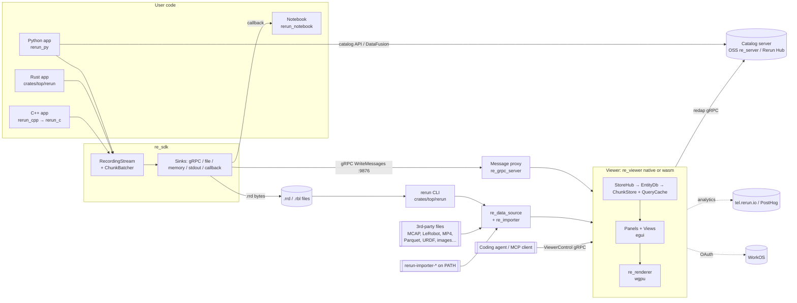
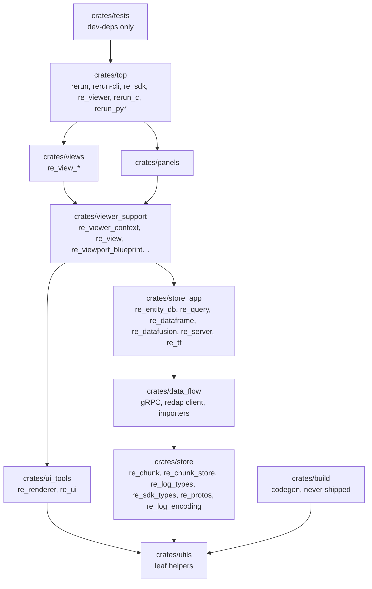

# 02 — Architecture

## 1. System context



Evidence for the edges:

- SDK → proxy: `crates/top/re_sdk/src/log_sink.rs` `GrpcSink` → `crates/data_flow/re_grpc_client/src/write.rs:133`.
- Proxy → viewer: `crates/data_flow/re_grpc_server/src/lib.rs:673` → `crates/top/re_viewer/src/app/add_data_source.rs:27`.
- Files → viewer: `crates/data_flow/re_data_source/src/data_source.rs:248` → `crates/data_flow/re_importer/src/import_file.rs:136`.
- Viewer ↔ catalog: `crates/data_flow/re_redap_client`.
- Agent → viewer: `crates/data_flow/re_grpc_server/src/viewer_control.rs`, `crates/top/re_viewer_mcp`.

## 2. Layered crate architecture

The folders under `crates/` are layers.
A crate may depend only on its own folder or a lower one.
`scripts/check_crate_dependencies.py` enforces this in CI (`reusable_checks.yml`), and the layer list itself is in `scripts/crate_layers.py`.



`*` `rerun_py/` lives outside `crates/` but is folded into the top layer (`ARCHITECTURE.md`).
`views` and `panels` are siblings, as are the `store_app/data_flow/store` stack and `ui_tools`: neither side of a pair may depend on the other (`crates/README.md`).

### Data flow pipeline (the "one picture" to remember)

```
SDK log call
  → Arrow component batches                    (re_sdk_types / Python generated code)
  → PendingRow → Chunk                         (re_chunk::ChunkBatcher)
  → LogMsg::ArrowMsg                           (re_log_msg)
  → protobuf transport + LZ4 + Arrow IPC       (re_log_encoding, re_protos)
  → gRPC / .rrd file / stdout
  → decode + Sorbet migration                  (re_log_encoding, re_sorbet)
  → LogReceiver channel                        (re_log_channel)
  → EntityDb::add_log_msg → ChunkStore::insert_chunk   (re_entity_db, re_chunk_store)
  → store events → QueryCache / subscribers    (re_query, re_viewer_context)
  → per frame: blueprint → view queries → visualizers → re_renderer draw data → wgpu
```

## 3. Module classification

Classification key:

- **CORE:** the product cannot function without it.
- **MAIN:** a primary user-facing or business-critical feature.
- **SUPPORTING:** a utility or narrower helper.
- **PERIPHERAL:** optional, experimental, dev-only, or thin.

Evidence comes from dependent counts (the number of workspace `Cargo.toml` files that name the crate, counted by the audit), entry points, and registration in `re_viewer`.

### crates/store and crates/store_app

| Crate | Class | Evidence |
| --- | --- | --- |
| `re_log_types` | CORE | 65 dependents; defines `EntityPath`, `StoreId`, the time types |
| `re_sdk_types` | CORE | 54 dependents; every built-in archetype and component (generated) |
| `re_chunk` | CORE | 39 dependents; the unit of logging, transport and storage |
| `re_chunk_store` | CORE | 34 dependents; the in-memory DB |
| `re_types_core` | CORE | 30 dependents; type traits, `RowId`, `ChunkId`, `ComponentDescriptor` |
| `re_sorbet` | CORE | 26 dependents; Arrow schema conventions and migrations |
| `re_log_msg` | CORE | 25 dependents; the `LogMsg` enum |
| `re_entity_db` | CORE | 24 dependents; the viewer's per-recording DB |
| `re_protos` | CORE | 18 dependents; every gRPC and `.rrd` wire format |
| `re_log_encoding` | CORE | 17 dependents; owns the `.rrd` format |
| `re_chunk_index` | MAIN | 21 dependents; manifests for lazy loading |
| `re_query` | MAIN | 13 dependents; query cache |
| `re_dataframe` | MAIN | Backs the public dataframe API |
| `re_datafusion` | MAIN | DataFusion over redap; Python `catalog` |
| `re_server` | MAIN | OSS catalog server (`rerun server`, `rr.server.Server`) |
| `re_uri`, `re_log_channel`, `re_lenses_core`, `re_catalog_client` | SUPPORTING | Moderate fan-in |
| `re_tf` | SUPPORTING (hot path) | Only 2 dependents, but it is on every spatial view's hot path |
| `re_chunk_optimizer`, `re_arrow_json` | PERIPHERAL | 2 and 1 consumers (CLI/Python; `re_viewer`) |

### crates/top, crates/data_flow, SDK packages

| Crate | Class | Evidence |
| --- | --- | --- |
| `rerun-cli` | CORE | The shipped `rerun` binary (`Cargo.toml:32-34`) |
| `rerun` | CORE | Rust SDK facade plus every CLI command |
| `re_sdk` | CORE | `RecordingStream`, used by all SDKs |
| `rerun_py` | CORE | Most-used SDK; 2 of the top-10 most-changed files |
| `re_data_source`, `re_importer` | CORE | Every file and URL load goes through them |
| `re_grpc_server`, `re_grpc_client` | CORE | Live SDK → viewer streaming |
| `rerun_c`, `rerun_cpp` | MAIN | C++ SDK |
| `re_redap_client` | MAIN | Catalog/Hub client; 14 dependents |
| `re_mcap` | MAIN | MCAP is a headline format (`README.md`) |
| `re_lerobot`, `re_parquet`, `re_mp4_reader`, `re_lenses` | SUPPORTING | Importer back-ends |
| `re_web_viewer_server`, `rerun_js`, `rerun_notebook` | SUPPORTING | Web/notebook distribution |
| `re_viewer_mcp` | PERIPHERAL | Agent tooling; only `rerun` depends on it |
| `re_hdf5` | PERIPHERAL | Only `rerun_py` uses it; not registered in `re_importer` |

### Viewer (crates/top/re_viewer, viewer_support, panels, views, ui_tools)

| Crate | Class | Evidence |
| --- | --- | --- |
| `re_viewer` | CORE | The app (30 k LOC) |
| `re_viewer_context` | CORE | 32 dependents |
| `re_viewport_blueprint` | CORE | 23 dependents |
| `re_view` | CORE | 16 dependents |
| `re_viewport` | CORE | On the frame hot path |
| `re_ui` | CORE | 36 dependents |
| `re_renderer` | CORE | 11 dependents; all GPU drawing |
| `re_view_spatial` | CORE | The 2D and 3D views; 227 snapshots |
| `re_view_time_series`, `re_view_dataframe`, `re_view_tensor`, `re_view_text_log` | MAIN | Registered in `crates/top/re_viewer/src/default_views.rs:23-98` |
| `re_selection_panel`, `re_time_panel`, `re_blueprint_tree`, `re_recording_panel`, `re_redap_browser` | MAIN | The always-visible app panels |
| `re_data_ui`, `re_component_ui`, `re_component_fallbacks`, `re_dataframe_ui` | MAIN | Component UIs, fallbacks, tables |
| `re_view_state_timeline`, `re_view_graph`, `re_view_bar_chart`, `re_view_text_document`, `re_view_raw_data`, `re_view_map` | SUPPORTING | Secondary views |
| `re_chunk_store_ui`, `re_context_menu`, `re_time_ruler`, `re_viewer_control_tools`, `re_arrow_ui`, `re_plot` | SUPPORTING | Narrower helpers |
| `re_view_audio` | PERIPHERAL | Optional (feature `audio`) |
| `re_agent_panel`, `re_agent_ui` | PERIPHERAL | Experimental; gated by `AppOptions.experimental.agent_panel` (default false, `re_viewer_context/src/app_options.rs:258`) |
| `re_memory_view` | PERIPHERAL | Dev panel only |
| `re_gamepad` | PERIPHERAL | Experimental |
| `re_renderer_examples` | PERIPHERAL | Demo; nothing depends on it |

### crates/utils, crates/build, crates/tests

| Crate(s) | Class | Evidence |
| --- | --- | --- |
| `re_log` (91), `re_tracing` (70), `re_byte_size` (47), `re_format` (43), `re_arrow_util` (32), `re_error` (32), `re_span` (27), `re_async` (23), `re_quota_channel` (20), `re_tuid` (14), `re_string_interner` | CORE utilities | Non-dev dependent counts |
| `re_video`, `re_memory`, `re_auth`, `re_analytics`, `re_perf_telemetry`, `re_build_info`, `re_audio`, `re_agent` | MAIN utilities | Each backs a product feature |
| `re_mutex`, `re_web`, `re_int`, `re_backoff`, `re_rvl`, `re_capabilities`, `re_case`, `re_byte_size_derive`, `re_grpc_headers` | SUPPORTING | Small helpers |
| `re_ros_msg`, `re_dump_puffin`, `re_crash_handler` | PERIPHERAL | 1–2 users each |
| `re_workspace_hack` | Build infra | cargo-hakari; no code |
| `re_type_definitions`, `re_types_builder`, `re_types_builder_macros`, `re_types_builder_prelude`, `re_protos_builder`, `re_build_tools` | SUPPORTING (critical tooling) | Codegen and build scripts; never shipped |
| `re_dev_tools` | SUPPORTING | Builds examples and the search index |
| `re_test_context`, `re_test_viewport`, `re_redap_tests` | SUPPORTING (test infra) | `re_redap_tests` is the published protocol-conformance suite |
| `re_renderer_tests`, `re_web_tests` | SUPPORTING (test infra) | — |
| `re_test_mocks` | Partially DEAD | `MockPostHog` and `assert_sink_empty!` (about 600 LOC) have no users; only `MockOtlpCollector` is used (`re_perf_telemetry/src/telemetry.rs:1309`) |

**Dead code.**
No workspace crate is dead.
Every crate with zero non-dev dependents has a bin, cdylib, staticlib or test harness, or is codegen input.
The one dead piece is `crates/tests/re_test_mocks/src/posthog.rs`.
Two example crates are excluded from the workspace: `examples/rust/revy` and `examples/rust/chess_robby_fischer` (`Cargo.toml:23`).

## 4. Dependency graph: coupling and hidden global state

- **Cycles.** Cargo forbids crate cycles, and the layer check forbids upward edges, so there are no circular crate dependencies.
  To see the real graph, run `pixi run crate-graph` (writes `crate_graph.svg`, an LFS file) or `cargo depgraph --workspace-only` (`ARCHITECTURE.md`).
- **Fan-in hotspots.** These are the crates where a change ripples furthest:
  - `re_log_types` (65)
  - `re_sdk_types` (54)
  - `re_chunk` (39)
  - `re_ui` (36)
  - `re_chunk_store` (34)
  - `re_viewer_context` (32)
- **Fan-out hotspots.** These are the crates that are slowest to compile and easiest to break:
  - `re_viewer` depends on every view and panel.
  - `re_viewer_context` depends on about 33 `re_*` crates.
  - `rerun_py` depends on nearly all of `data_flow` and `store_app`.
- **Tight coupling:**
  - `crates/top/rerun/src/commands/entrypoint.rs` (2 454 LOC) orchestrates the CLI, viewer, servers, auth and analytics behind many feature flags.
  - `AppCore` (`crates/top/re_viewer/src/app/mod.rs:125-201`, about 35 fields) is the viewer god object.
  - `rerun_cpp/src/rerun/c/rerun.h` must stay in sync with `crates/top/rerun_c/src/lib.rs` by hand.
- **Hidden global state** (full list in the audit notes; main items here):

  | Global | Location | Effect |
  | --- | --- | --- |
  | `SUBSCRIBERS` | `crates/store/re_chunk_store/src/subscribers.rs:86` | Process-wide chunk-store subscriber registry; subscribers see events from **every** store. Viewer subsystems register through `OnceLock` statics: `re_viewer_context/src/annotations.rs:320`, `re_time_panel/src/recursive_chunks_per_timeline_subscriber.rs:77`, `re_view_spatial/src/{max_image_dimension_subscriber.rs:74, spatial_topology.rs:137}`. |
  | `GLOBAL_DATA_RECORDING`, `GLOBAL_BLUEPRINT_RECORDING` + thread-locals | `crates/top/re_sdk/src/global.rs:67-74` | SDK global recordings |
  | `ALL_RECORDINGS`, `GARBAGE_QUEUE`, `RUNTIME` | `rerun_py/src/python_bridge.rs:55,94`; `rerun_py/src/utils.rs:17` | Python SDK process state |
  | `RECORDING_STREAMS` | `crates/top/rerun_c/src/recording_streams.rs:41` | C SDK handle table |
  | `GLOBAL_INTERNER` | `crates/utils/re_string_interner/src/lib.rs:588` | Never freed |
  | `BUILTIN_IMPORTERS`, `CUSTOM_IMPORTERS`, `EXTERNAL_IMPORTER_PATHS` | `crates/data_flow/re_importer/src/lib.rs:531,560`; `importer_external.rs:37` | `$PATH` is scanned once per process |
  | `ADD_VIEW_OR_CONTAINER_MODAL` | `crates/viewer_support/re_viewport_blueprint/src/ui/mod.rs:13` | UI state kept in a global mutex |
  | Env values cached on first read | `re_log` `PANIC_ON_WARN`; `re_auth` OAuth config; `re_datafusion` `CHUNK_STRATEGY` | Changing these env vars after startup has no effect |

  `lazy_static!` is not used at all.
  There are 13 non-test `thread_local!`s.
  Of roughly 1 000 statics, 902 are generated `DESCRIPTOR` `LazyLock`s in `re_sdk_types`.

## 5. Entry points

| Kind | Entry point | Location |
| --- | --- | --- |
| Binary | `rerun`: viewer, CLI and servers | `crates/top/rerun-cli/src/bin/rerun.rs:19` → `crates/top/rerun/src/commands/entrypoint.rs:721` |
| Binary | `re-viewer-mcp` (also `rerun viewer-mcp`) | `crates/top/re_viewer_mcp/src/main.rs:5` |
| Binary | `re_grpc_server` (feature `bin`) | `crates/data_flow/re_grpc_server/src/main.rs:5` |
| Binary | standalone `viewer` | `crates/top/re_viewer/src/bin/viewer/main.rs:24` (used by `pixi run rerun-build-fast`) |
| CLI subcommands | `analytics`, `auth`, `download`, `dump-puffin`, `man`, `mcap`, `viewer-mcp`, `reset`, `rrd {compare,filter,merge,migrate,optimize,compact,print,route,split,stats,verify}`, `server` | `entrypoint.rs:637-704` |
| Python console script | `rerun` → bundled binary (or `$RERUN_CLI_PATH`) | `rerun_py/pyproject.toml [project.scripts]`, `rerun_py/rerun_sdk/rerun_cli/__main__.py:22` |
| Python module | `import rerun` → `#[pymodule] rerun_bindings` | `rerun_py/src/python_bridge.rs:184` |
| C ABI | 28 `rr_*` functions | `crates/top/rerun_c/src/lib.rs` |
| Wasm | `WebHandle` (`#[wasm_bindgen]`) | `crates/top/re_viewer/src/web.rs:30` |
| JS | `class WebViewer` | `rerun_js/web-viewer/index.ts:1307` |
| Notebook | `rerun_notebook.Viewer` (anywidget) | `rerun_notebook/src/rerun_notebook/__init__.py:162` |
| Servers | gRPC proxy (:9876), web viewer HTTP (:9090), OSS catalog (`rerun server`, default redap port 51234), OAuth callback (127.0.0.1:17340-17349), puffin (:8585 with `--profile`) | See `04-DATA-AND-FLOWS.md` §2 |
| External plugins | `rerun-importer-*` executables on `$PATH` | `crates/data_flow/re_importer/src/importer_external.rs:16` |
| Build scripts | codegen `re_types_builder`, `re_protos_builder`; `build.rs` in `re_web_viewer_server` (asserts wasm exists), `re_renderer` (embeds shaders), `re_protos` (descriptor set), `rerun_py` | `crates/build/*`, each crate's `build.rs` |
| Cron jobs, workers, event consumers | There are no cron jobs in product code. Background threads are the SDK batcher and forwarding threads, the gRPC client thread, importer threads, the viewer's chunk prefetcher, and server tasks (`re_server` `TaskRegistry`). There is no scheduled CI either; `nightly.yml` was removed in `164e709e0d`. | — |
