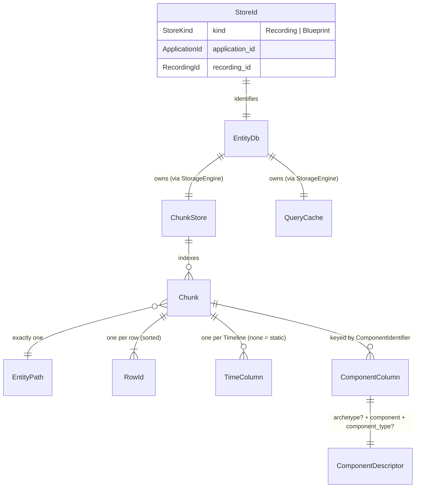

# 04 — Data models, API surface, flows, configuration

## 1. Data models

Rerun has no relational database and no SQL migrations.
Its data model is a set of **Arrow-based types defined in Rust**.
Most of them are generated from an IDL, and they are persisted as `.rrd` files.

### 1.1 Core entities and relationships

| Concept | Definition | Evidence |
| --- | --- | --- |
| **EntityPath** | A hierarchical path such as `/world/robot/arm`, hashed. Roots starting with `__` are reserved; for example `/__properties` holds recording properties. | `crates/store/re_log_types/src/path/entity_path.rs:94`, `entity_path_part.rs:7` |
| **Timeline / TimeType** | A named index whose type is `Sequence`, `DurationNs` or `TimestampNs`. A recording can have many timelines. `log_time` and `log_tick` are injected by the SDK. | `re_log_types/src/index/timeline.rs:19`, `time_type.rs:28`; `RERUN_LOG_TIME`/`RERUN_LOG_TICK` (`crates/top/re_sdk/src/recording_stream.rs:53-58`) |
| **TimeInt / TimePoint** | `TimeInt(Option<NonMinI64>)`; `STATIC` is stored as `i64::MIN`. `TimePoint` maps timeline names to time cells; the empty map means static. | `re_log_types/src/index/time_int.rs:20-53`, `time_point.rs:24,66` |
| **Static vs temporal** | Static data has no time, exists on every timeline, and always shadows temporal data of the same component. It is never GC'd. | `re_log_types/src/index/time_point.rs:10-11`, `crates/store/re_chunk_store/src/store.rs:664` |
| **StoreId / StoreKind** | `{kind, application_id, recording_id}`. Uniqueness is *not* enforced: data with the same StoreId is pooled into one recording. Blueprints are their own stores. | `re_log_types/src/store_id.rs:28,92-117` |
| **RowId / ChunkId** | 16-byte TUIDs (big-endian nanoseconds + counter), so they sort by creation. The RowId breaks ties between equal times. A ChunkId must be unique per recording. | `crates/utils/re_tuid/src/lib.rs:54`, `crates/store/re_types_core/src/row_id.rs:67`, `chunk_id.rs:48` |
| **Chunk** | One entity × N rows. Contains RowIds, time columns, and sparse `ListArray` component columns. | `crates/store/re_chunk/src/chunk.rs:242` |
| **ComponentDescriptor** | `{archetype: Option<ArchetypeName>, component: ComponentIdentifier, component_type: Option<ComponentType>}`. The identifier is, for example, `Points3D:positions`. | `crates/store/re_types_core/src/component_descriptor.rs:21`, `archetype.rs:191-203` |
| **Archetype → Components → Encodings** | The three-level type system, defined in `crates/build/re_type_definitions/rerun/{archetypes,components,encodings,blueprint}/*.def.rs` (333 files). | `AGENTS.md` "Type system hierarchy" |
| **LogMsg** | `SetStoreInfo`, `ArrowMsg(StoreId, Arc<ChunkBatch>)` or `BlueprintActivationCommand`. Tables travel as `TableMsg` and are never written to `.rrd`. | `crates/store/re_log_msg/src/log_msg.rs:17-83`, `table_msg.rs` |
| **Blueprint** | A normal store of kind `Blueprint` on the `"blueprint"` sequence timeline. Paths are `/viewport`, `/container/{id}`, `/view/{id}`, `/view/{id}/defaults`, plus per-entity overrides. | `crates/viewer_support/re_viewer_context/src/blueprint_helpers.rs:32-37`, `re_viewport_blueprint/src/view.rs:57` |
| **Catalog entities (redap)** | Entries are datasets or tables. A dataset is a grid of segments × layers. In redap contexts, application id ≈ dataset entry id and recording id ≈ segment id. | `crates/store_app/re_server/src/store/{dataset,segment,source}.rs`, `re_log_types/src/store_id.rs` doc |

### 1.2 Arrow and `.rrd` physical format

**Chunk as an Arrow `RecordBatch`** (`crates/store/re_chunk/src/transport.rs:27`, `crates/store/re_sorbet/`):

- **Columns:**
  - A RowId column of type `FixedSizeBinary(16)`.
  - One index column per timeline.
  - One `List<T>` column per component.
- **Schema metadata:** `sorbet:version` (`0.1.4`), `rerun:id`, `rerun:entity_path`.
- **Field metadata:** `rerun:kind`, `rerun:component`, `rerun:archetype`, `rerun:component_type`, `rerun:is_static`, `rerun:is_sorted`, `rerun:index_name`.

**`.rrd` stream layout** (`crates/store/re_log_encoding/src/rrd/frames.rs`). Each stream is laid out as follows:

1. **`StreamHeader`** (12 bytes):
   - the FourCC `RRF2`;
   - the 4-byte crate version;
   - `EncodingOptions` (compression: Off or LZ4; serializer: Protobuf).
2. **Messages.** Each one is a 16-byte `MessageHeader {kind: u64, len: u64}` followed by a protobuf payload.
   - Kinds: End=0, SetStoreInfo=1, ArrowMsg=2, BlueprintActivationCommand=3.
   - An ArrowMsg payload is Arrow IPC *stream* bytes, LZ4-compressed per message when that pays off.
3. **`End` message.** Its payload is an `RrdFooter` holding one `RawRrdManifest` per store, which gives each chunk's byte offset and size. That makes random access and lazy loading possible.
4. **`StreamFooter`** (`RRF2` + `FOOT` + byte span + xxh32 checksum), so a reader can seek to the footer from the end of the file (`footer_reader.rs:14-20`).

Concatenated streams (`cat a.rrd b.rrd`) are supported (`decoder/state_machine.rs:254-272`).
Payloads are capped at 16 GiB (`crates/store/re_protos/src/v1alpha1/rerun.common.v1alpha1.ext.rs:1314`).

### 1.3 Migration strategy (the closest thing to "DB migrations")

- **Compatibility policy:** the current version always opens files written by the *previous* version; there is no guarantee for older ones (`ARCHITECTURE.md` ".rrd files", `RELEASES.md`).
  - A header version below 0.23 is a hard error (`frames.rs:117-145`).
  - The old FourCCs `RRF0`/`RRF1` are rejected (`frames.rs:192`).
- **Data migrations run on every decode:**
  - `re_sorbet::migrate_record_batch` (`crates/store/re_sorbet/src/migrations/mod.rs`) upgrades a batch based on `sorbet:version`, or a guessed version for older data.
  - The chain is 0.0.1 → 0.0.2 → 0.1.0 → 0.1.1 → 0.1.2 → 0.1.3 → 0.1.4. Examples: TUID encoding, the descriptor format, dropping indicator columns, Pose* → transforms, `SeriesVisible` → `Visible`, and blueprint `cell_kind` → `column_type`.
  - **To add a migration:** bump `METADATA_VERSION` and add a module in `migrations/` (`migrations/mod.rs:1-6`).
- **Offline migration:** `rerun rrd migrate <files>` (`crates/top/rerun/src/commands/rrd/migrate.rs`).
- **Blueprints:** no separate migrator was found. Blueprints are chunks and go through the same Sorbet migrations. Whether a viewer-side migrator also exists is UNVERIFIED.
- **Proto evolution:** `buf breaking` runs against `origin/main` (`pixi run pb-breaking`, `.github/workflows/reusable_checks_protobuf.yml`).
- **Back-compat corpus:** `tests/assets/rrd/**` is checked by `pixi run check-backwards-compatibility`, which runs `rrd verify`.
- **Seed and test data:**
  - `tests/assets/` (rrd corpus, mcap, video, meshes, images; large files in git-LFS);
  - `examples/assets/`;
  - `crates/store/re_log_types/src/example_components.rs` (test fixtures);
  - `tests/python/chunk_zoo`.

## 2. API surface

### 2.1 gRPC services

Defined in `crates/store/re_protos/proto/rerun/v1alpha1/`.

| Service | RPCs | Server | Client | Auth |
| --- | --- | --- | --- | --- |
| `MessageProxyService` (`sdk_comms.proto:30`) | `WriteMessages` (client stream), `ReadMessages` (server stream), `WriteTable`, `ReadTables` | `crates/data_flow/re_grpc_server/src/lib.rs:1349-1430` | `crates/data_flow/re_grpc_client` | **None.** CORS allowlist is localhost + `*.rerun.io` (`lib.rs:157-188`). |
| `ViewerControlService` (`viewer_control.proto:55`) | `ViewerControl`, `EguiInspect` | `re_grpc_server/src/viewer_control.rs`, implemented in `crates/top/re_viewer/src/app/viewer_control/mod.rs:332` | `crates/top/re_viewer_mcp`, the JS `WebViewer` | `LoopbackOnly` interceptor (`re_grpc_server/src/lib.rs:197`) |
| `RerunCloudService` (`cloud.proto:40-381`, 42 RPCs) | **Misc:** Version, WhoAmI, DoBandwidthTest, WatchEvents. **Entries:** Find/Delete/Update entry, Create/Read/Update dataset and table entries. **Uploads:** GetWriteAccessGrant, multipart grants/complete/abort. **Registration:** RegisterWithDataset, UnregisterFromDataset. **Schemas and manifests:** GetSegmentTableSchema, ScanSegmentTable, GetDatasetManifestSchema, ScanDatasetManifest, GetDatasetSchema, GetSchemas, GetRrdManifest, GetAssetsForSegment. **Segment properties:** Get/Set/Delete. **Chunks:** QueryDataset (deprecated), FindChunks, FetchChunks. **Tables:** RegisterTable, GetTableSchema, ScanTable, WriteTable. **Tasks:** QueryTasks, QueryTasksOnCompletion, CancelTasks. **Maintenance:** DoMaintenance, DoGlobalMaintenance. | OSS: `crates/store_app/re_server/src/rerun_cloud/mod.rs`. Hub: closed source. | `crates/data_flow/re_redap_client`, `crates/store_app/re_catalog_client`, `re_datafusion` | JWT bearer tokens via a tower layer (`re_redap_client/src/grpc.rs:314-378`, `crates/utils/re_auth/src/service/`) |

**Conformance suite:** `crates/tests/re_redap_tests`, run against `re_server` by `cargo nextest run -p re_server --all-features` (`TESTING.md`).

**Unimplemented in OSS** (return `unimplemented`):
- `DoMaintenance`, `DoGlobalMaintenance`
- the multipart upload RPCs
- parts of `RegisterTable` and `CreateTableEntry`

### 2.2 HTTP, URIs and ports

| Item | Value | Evidence |
| --- | --- | --- |
| gRPC proxy / viewer port | 9876 | `crates/store/re_uri/src/lib.rs:76` (also `re_grpc_server/src/lib.rs:43`, `entrypoint.rs:84`) |
| Web viewer HTTP | 9090 (tiny_http; serves the embedded wasm and JS) | `crates/top/re_web_viewer_server/src/lib.rs:17` |
| redap default port | 51234 | `re_uri/src/lib.rs` `DEFAULT_REDAP_PORT` |
| OAuth callback | 127.0.0.1:17340–17349 | `crates/utils/re_auth/src/callback_server.rs:17,28` |
| Puffin profiler | 0.0.0.0:8585 (with `--profile` only) | `crates/utils/re_tracing/src/server.rs:29` |
| OSS server extra HTTP routes | Signed upload grants (`{claims}.{signature}`, HMAC) | `crates/store_app/re_server/src/routes.rs` |
| URI schemes | `rerun://` (= `rerun+https`), `rerun+http://`, `rerun+https://` | `re_uri/src/scheme.rs:7-62` |
| URI forms | `/proxy`, `/catalog`, `/dataset/<id>[?segment_id=…][#time_selection=…]`, `/dataset/<id>/assets`, `/folder/<prefix>`, entry/table | `re_uri/src/lib.rs:17-38` |
| SDK default connect URL | `rerun+http://127.0.0.1:9876/proxy` | `crates/top/re_sdk/src/lib.rs:45` |

### 2.3 Programmatic APIs

| SDK | Where it's defined |
| --- | --- |
| Python | `rerun_py/rerun_sdk/rerun/` (`init`, `spawn`, `connect_grpc`, `save`, `serve_grpc`, `log`, `send_columns`, `set_time`, `rerun.catalog`, `rerun.dataframe`, `rerun.experimental`); stubs in `rerun_py/rerun_bindings/rerun_bindings.pyi` |
| Rust | `crates/top/rerun` (re-exports `re_sdk`) |
| C++ | `rerun_cpp/src/rerun/` |
| C | `rerun.h` |
| JS | `WebViewer` methods (`rerun_js/web-viewer/index.ts`) |

API docs are published to ref.rerun.io (Python/C++/JS) and docs.rs (Rust).

### 2.4 Authentication and authorization model

- **Local streaming (proxy):** no authentication. The defaults bind to `0.0.0.0` (`entrypoint.rs:163`, `re_sdk/src/web_viewer.rs:190`, `re_server/src/entrypoint.rs:19`). Only browsers are limited, and only by CORS.
- **Viewer control:** loopback only.
- **Redap (Hub / OSS server):**
  - OAuth (WorkOS, PKCE, localhost callback) via `rerun auth login`. Tokens are stored in `~/.config/rerun/credentials.json` on native and in `localStorage` on web (`re_auth/src/oauth/storage.rs:65-161`).
  - JWT validation: RS256 via JWKS for WorkOS, or HS256 with a shared secret (`RedapProvider`, `re_auth/src/provider.rs:100-133`).
  - Tokens carry an allowed-hosts claim (`re_auth/src/token.rs:175`).
  - Client credential order: stored → fallback → `REDAP_TOKEN` → none (`re_redap_client/src/connection_registry.rs:325-400`).
  - `rerun auth generate-token --permission read|read-write` mints tokens (`crates/top/rerun/src/commands/auth.rs`).
  - How the OSS server authorizes requests is UNVERIFIED: whether `re_server` enforces auth by default was not confirmed.

### 2.5 Validation and error-handling conventions

- **Validation at boundaries:**
  - `Chunk::sanity_check` (`re_chunk/src/chunk.rs:1822`);
  - Sorbet schema parsing and migration;
  - payload and LZ4 size caps;
  - proto → Rust conversion with `missing_field!`/`invalid_field!` returning `TypeConversionError` (`crates/store/re_protos/src/lib.rs:~225-305`).
- **Rust errors:** `thiserror` enums per crate (for example `ChunkStoreError`, `ChunkError`), with `anyhow` at the edges.
  - Message style: the error first, the file path last (`AGENTS.md` "Code conventions").
  - Use `re_error::format` to print error chains.
- **Panics:**
  - `unwrap` is warned on by clippy outside tests (`Cargo.toml` workspace lints, `clippy.toml` `allow-unwrap-in-tests`).
  - Release builds use `panic="abort"`.
  - In tests, `RERUN_PANIC_ON_WARN` turns `re_log::warn!` into a panic.
- **Python:** warnings by default. `RERUN_STRICT=1` (or `rr.set_strict_mode`) makes them raise (`rerun_py/rerun_sdk/rerun/error_utils.py:20`).
- **gRPC:** `tonic::Status`. The client classifies errors in `re_redap_client/src/api_error.rs` and retries with `with_retry*` (`src/lib.rs:235,263`).

## 3. Traced end-to-end flows

### Flow A — Python `rr.init(); rr.spawn(); rr.log("x", rr.Points3D(p))` → viewer store

**Python and binding setup**
1. `import rerun` runs `#[pymodule] rerun_bindings` (`rerun_py/src/python_bridge.rs:184`).
2. `rerun.init` (`rerun_py/rerun_sdk/rerun/__init__.py:278`) calls `cleanup_if_forked_child`, then `flush_and_cleanup_orphaned_recordings` (`:386`), then `bindings.new_recording` (`:393`).
3. `new_recording` (`python_bridge.rs:661`) calls `RecordingStreamBuilder…buffered()` (`crates/top/re_sdk/src/recording_stream.rs:396`), then `RecordingStreamInner::new` (`:989`).
   - That creates the `ChunkBatcher` (`crates/store/re_chunk/src/batcher.rs:129`) and the `forwarding_thread` (`recording_stream.rs:1644`).
   - The new stream is set as the global recording.

**Spawning the viewer**
4. `rr.spawn` (`rerun/sinks.py:463`) calls `_spawn.py:69`, which calls `bindings.spawn` (`python_bridge.rs:1058`), which calls `re_sdk::spawn` (`crates/top/re_sdk/src/spawn.rs:205`).
   - This launches the `rerun` binary on PATH with `--port 9876 --expect-data-soon`, then polls until the port is bound (`:424`).
5. In the child process: `rerun.rs:19` → `entrypoint.rs:721 run` → `run_impl` (`:1036`) → `start_native_viewer` (`:1220`).
   - It binds `ServerListener` (`:1272`) and calls `re_grpc_server::spawn_with_recv_and_services` (`:1299`, `re_grpc_server/src/lib.rs:673`).
   - The resulting `LogReceiver` goes to `App::add_log_receiver` (`crates/top/re_viewer/src/app/add_data_source.rs:27`).

**Connecting the sink**
6. Back in Python: `connect_grpc` (`sinks.py:542`) → `bindings.connect_grpc` (`python_bridge.rs:1364`) → `GrpcSink::new` (`re_sdk/src/log_sink.rs:597`).
7. `GrpcSink::new` starts `re_grpc_client::write::Client` (`crates/data_flow/re_grpc_client/src/write.rs:133`) on its own thread.
8. `set_sink` (`recording_stream.rs:2001`) swaps the sink in, replays the buffered backlog, and switches the batcher to the low-latency config (8 ms tick).

**Logging**
9. `rr.log` (`rerun/_log.py:20`) → `_log_components` (`:139`) → `bindings.log_arrow_msg` (`python_bridge.rs:2301`) → `build_row_from_components` (`rerun_py/src/arrow.rs:62`, Arrow C-FFI import).
10. The binding releases the GIL and calls `RecordingStream::record_row` (`recording_stream.rs:1858`), which calls `ChunkBatcher::push_row` (`batcher.rs:494`).
11. `batching_thread` (`batcher.rs:573`) flushes on the tick or the byte threshold.
12. `forwarding_thread` turns each chunk into `to_arrow_msg` → `LogMsg::ArrowMsg` → `GrpcSink::send` (`log_sink.rs:630`).
13. The client converts with `to_transport`, wraps the result in a `WriteMessagesRequest`, and streams it (`write.rs:428-480`).

**Receiving in the viewer**
14. `MessageProxy::write_messages` (`re_grpc_server/src/lib.rs:1350`) pushes into the history and broadcasts.
15. The receive loop (`:700-760`) calls `to_application`, which runs Sorbet migration (`re_log_encoding/src/transport_to_app.rs:280-364`), then sends a `DataSourceMessage::LogMsg`.
16. On the viewer UI thread: `App::receive_messages` (`re_viewer/src/app/logic.rs:154`, 10 ms budget) → `receive_log_msg` (`:309`) → `EntityDb::add_log_msg` (`crates/store_app/re_entity_db/src/entity_db.rs:847`).
17. `add_log_msg` → `add_chunk_batch` (`:868`) → `Chunk::from_chunk_batch` (`re_chunk/src/transport.rs:161`) → `ChunkStore::insert_chunk` (`crates/store/re_chunk_store/src/writes.rs:53`).
    - `insert_chunk` splits, indexes and compacts the chunk, then emits events.
18. `EntityDb::on_store_events` (`entity_db.rs:918`) calls `QueryCache::on_events` (`crates/store_app/re_query/src/cache.rs:312`). Global subscribers are notified as well.

### Flow B — the viewer draws that data on the next frame

1. `AppCore::frame_ui` (`re_viewer/src/app/mod.rs:1375`) → `AppState::show` (`re_viewer/src/app_state.rs:303`).
2. `AppState::show` builds the blueprint model:
   - `ViewportBlueprint::from_db` (`crates/viewer_support/re_viewport_blueprint/src/viewport_blueprint.rs:80`);
   - `query_results_for_views` (`data_query_result_cache.rs:29`) gives each view its data results and visualizer instructions.
3. `ViewportUi::viewport_ui` (`crates/panels/re_viewport/src/viewport_ui.rs:55`) → `execute_systems_for_all_views` (`system_execution.rs:9`, rayon over the tiles) → `re_view::execute_systems_for_view` (`crates/viewer_support/re_view/src/system_execution.rs:121`).
4. `Points3DVisualizer::execute` (`crates/views/re_view_spatial/src/visualizers/points3d.rs:382`) runs the query:
   - `query_archetype_with_history` (`re_view/src/query.rs:763`) → `EntityDb`/`QueryCache::latest_at` or range;
   - for a latest-at query: `re_query/src/latest_at.rs:43` → `ChunkStore::latest_at_relevant_chunks` (`re_chunk_store/src/query.rs:906`) → `Chunk::latest_at` (`re_chunk/src/latest_at.rs:109`).
5. The visualizer then fills a `PointCloudBuilder` and returns draw data (`points3d.rs:504-507`).
6. `SpatialView3D::ui` (`view_3d.rs:524`) → `ui_3d.rs:126`:
   - `ViewBuilder::new`, then `queue_draw` for each piece of draw data;
   - `gpu_bridge::new_renderer_callback` (`re_viewer_context/src/gpu_bridge/re_renderer_callback.rs`) hands the result to egui.
7. On paint, egui-wgpu calls `prepare`, which runs `ViewBuilder::draw` (`crates/ui_tools/re_renderer/src/view_builder.rs:751`).
   - The point cloud renderer (`renderer/point_cloud.rs:650,851`, shader `shader/point_cloud.wgsl`) draws into the view's own target.
   - `composite` (`:1004`) then draws that target into egui's pass.

### Flow C — `rerun recording.rrd` (CLI file open)

1. `main` → `run_inner` (`entrypoint.rs:739`):
   - installs the crash handler and analytics;
   - `Args::parse_from` (`:774`);
   - builds the thread pool and tokio runtime (`:820`).
2. `run_impl` (`:1036`) creates `ConnectionRegistry::new_with_stored_credentials` (`:1060`).
   - If port 9876 is free, it calls `start_native_viewer` (`:1199`).
   - Otherwise it forwards to the running viewer (`connect_to_existing_server`, `:1482`).
3. `App::open_url_or_file` (`re_viewer/src/app/mod.rs:762`) → `ViewerUrl::open` (`re_viewer_context/src/viewer_url.rs:708`) → `SystemCommand::LoadDataSource` → `App::load_data_source` (`add_data_source.rs:74`).
4. **Default path** (`.rrd`/`.rbl`, with app option `use_viewer_catalog = true`, `re_viewer_context/src/app_options.rs:114`):
   - `register_via_internal_catalog` (`add_data_source.rs:441`) → `register_rrd_file_url` (`:652`) registers the file with the in-process `re_server`.
   - The file is then streamed back as a `RedapDatasetSegment` via `stream_blueprint_and_segment_from_server` (`re_data_source/src/data_source.rs:335-366`).
   - On the server side, `ResolvedStore::load_rrd_file` (`re_server/src/store/resolved_store.rs:~115-160`) uses a lazy footer-backed `LazyStore`.
5. **Fallback path:**
   - `LogDataSource::stream_with_options` (`data_source.rs:248`) → `import_from_path` (`re_importer/src/import_file.rs:20`) → `RrdImporter` (`importer_rrd.rs:18`) → `Decoder` (`re_log_encoding/src/rrd/decoder/state_machine.rs`) → `send` (`import_file.rs:294`).
6. Either way the data ends up in `receive_messages` → `EntityDb`, as in Flow A steps 16–18.

### Flow D — `rerun drone.mcap` (importer path)

1. Same start as Flow C, except the catalog path is skipped: only rrd and rbl files are registered there (`add_data_source.rs:430-436`).
2. `import` (`re_importer/src/import_file.rs:136`):
   - MCAP is natively supported (`lib.rs:609`), so external plugins are skipped;
   - the built-in importers run in parallel, and only `McapImporter` accepts the file.
3. `McapImporter::import_from_path` (`re_importer/src/importer_mcap/importer.rs:227`):
   - starts a thread and memory-maps the file (`unsafe`, `:258`);
   - wraps it in `re_mcap::McapFile`;
   - `emit_chunks` (`:141`) runs the decoder registry (`crates/data_flow/re_mcap/src/decoders/*`) and lenses.
4. `send_chunk_to_channel` (`:379`, bounded 1024) → `send` → `LogSender` → the viewer.

### Flow E — dataset query from Python (`rerun.catalog` → DataFusion → server)

1. Python `CatalogClient` / dataset entry (`rerun_py/rerun_sdk/rerun/catalog/_entry.py`) → Rust `rerun_py/src/catalog/dataset_entry.rs` → `re_datafusion` `DataframeQueryTableProvider` (`crates/store_app/re_datafusion/src/dataframe_query_common/mod.rs`). Filters are pushed down in `pushdown_expressions.rs`.
2. The scan sends `FindChunks`.
   - Server side: `find_chunks` (`re_server/src/rerun_cloud/mod.rs:1925`) → `chunk_selection::select_chunks` (`chunk_selection.rs:116`) → `latest_at/range_relevant_chunks_for_all_components` on each store.
3. The v2 pipeline (`re_datafusion/src/pipeline/mod.rs:17`) sends `FetchChunks`.
   - Server side: `fetch_chunks` (`mod.rs:1867`) → `InMemoryStore::chunks_from_chunk_keys` (`in_memory_store.rs:96`) → `LazyStore` / `RrdChunkProvider::load_chunks`.
4. Fetched chunks go into a per-segment `ChunkStore`.
5. `re_dataframe::QueryHandle` (`crates/store_app/re_dataframe/src/query.rs:242`) builds Arrow batches ordered by `[rerun_segment_id, index]`, up to the "safe horizon". DataFusion returns them to Python as pyarrow.

## 4. Configuration reference

There is **no `.env` file** and no central config file.
Configuration comes from CLI flags (`rerun --help`, `docs/content/reference/cli.md`), SDK arguments, viewer settings, and these environment variables.
Everything is optional unless marked otherwise.
Secrets are marked 🔑; their values are never printed here.

### 4.1 SDK and logging

| Var | Default | Purpose | Evidence |
| --- | --- | --- | --- |
| `RERUN` | unset | Forces logging on or off globally | `crates/top/re_sdk/src/lib.rs:177-181` |
| `RERUN_STRICT` | off | Python raises instead of warning | `re_sdk/src/recording_stream.rs:975`, `rerun_py/rerun_sdk/rerun/error_utils.py:20` |
| `RERUN_FLUSH_TICK_SECS` | 0.2 (0.008 for gRPC) | Batcher tick | `crates/store/re_chunk/src/batcher.rs:219` |
| `RERUN_FLUSH_NUM_BYTES` | 2 MiB | Batcher byte threshold | `batcher.rs:222` |
| `RERUN_FLUSH_NUM_ROWS` | u64::MAX | Batcher row threshold | `batcher.rs:225` |
| `RERUN_CHUNK_MAX_ROWS_IF_UNSORTED` (old alias `RERUN_MAX_CHUNK_ROWS_IF_UNSORTED`) | 8192 | Unsorted chunk size | `batcher.rs:230-234` |
| `RERUN_CHUNK_MAX_BYTES`, `RERUN_CHUNK_MAX_ROWS`, `RERUN_STORE_ENABLE_CHANGELOG` | 384 KiB / 4096 / on | Store compaction thresholds | `crates/store/re_chunk_store/src/store.rs:141-188` |
| `RERUN_LOG_TICK` / `RERUN_LOG_TIME` | off / on | Inject the `log_tick` / `log_time` timelines | `recording_stream.rs:53-58` |
| `RERUN_CLI_PATH` | bundled binary | Override the viewer binary used by Python | `rerun_py/rerun_sdk/rerun_cli/__main__.py:23` |
| `RERUN_APP_ONLY` | — | Internal: marks a spawned viewer process | `python_bridge.rs:227`, `re_importer/src/importer_external.rs:175` |
| `_RERUN_TEST_FORCE_SAVE` | — | Test only: forces saving to a file | `recording_stream.rs:38` |

### 4.2 Viewer and rendering

| Var | Default | Purpose | Evidence |
| --- | --- | --- | --- |
| `RERUN_TRACK_ALLOCATIONS` | off | Allocation call-stack tracking (slow) | `crates/top/re_viewer/src/env_vars.rs:4` |
| `RERUN_MAPBOX_ACCESS_TOKEN` 🔑 | — | Mapbox tiles | `crates/viewer_support/re_viewer_context/src/app_options.rs:6,177` |
| `RERUN_SHADER_PATH`, `RERUN_WGSL_SHADER_DUMP_PATH` | — | Shader search path and dump directory (dev) | `crates/ui_tools/re_renderer/src/file_resolver.rs:205`, `wgpu_resources/shader_module_pool.rs:18` |
| `WGPU_BACKEND`, `WGPU_POWER_PREF` | auto | GPU backend (also `--renderer`) | CLI help `entrypoint.rs:48-52`; read by wgpu (exact names UNVERIFIED) |
| `EXAMPLES_MANIFEST_URL` | built-in | Welcome-screen examples | `entrypoint.rs:1417` |
| `RERUN_NOTEBOOK_ASSET` | CDN (app.rerun.io) | `serve-local`, `inline`, or a URL | `rerun_notebook/src/rerun_notebook/__init__.py:97-122` |
| `RERUN_DEV_ENVIRONMENT` | set by pixi | Notebook defaults to local assets | `pixi.toml` activation, `rerun_notebook/__init__.py:102` |
| `EGUI_INSPECTION` | off | egui-mcp inspection socket (UNVERIFIED for the main viewer) | `AGENTS.md` |
| `WAYLAND_DISPLAY`, `WAYLAND_SOCKET` | — | Linux window-decoration choice | `crates/ui_tools/re_ui/src/lib.rs:150-151` |

### 4.3 Network, auth, catalog

| Var | Default | Purpose | Evidence |
| --- | --- | --- | --- |
| `REDAP_TOKEN` 🔑 | — | Fallback JWT for redap | `crates/data_flow/re_redap_client/src/connection_registry.rs:879` |
| `RERUN_OAUTH_CLIENT_ID`, `RERUN_OAUTH_ISSUER_URL`, `RERUN_OAUTH_SERVER_URL` | WorkOS defaults | OAuth configuration | `crates/utils/re_auth/src/oauth/mod.rs:18,25`, `api.rs:13` |
| `RERUN_INSECURE_SKIP_HOST_CHECK` | off | `1` disables the JWT host binding (**insecure**) | `re_auth/src/token.rs:15,176` |
| `RERUN_REDAP_LOCAL_CERT_PATH` | — | Custom CA (SNI forced to `localhost`) | `re_redap_client/src/grpc.rs:47-66` |
| `RERUN_REDAP_CONNECTION_POOL_SIZE` | crate default (UNVERIFIED value) | gRPC pool size | `grpc.rs:159` |
| `RERUN_DATAFRAME_PIPELINE` | `v2` | `v1` selects the old pipeline | `crates/store_app/re_datafusion/src/pipeline/config.rs:19-27` |
| `RERUN_DATAFRAME_FETCH_CONCURRENCY`, `RERUN_DATAFRAME_WINDOW_BYTES` | 24 / 512 MiB | v2 pipeline knobs | `re_datafusion/src/pipeline/config.rs` |
| `RERUN_CHUNK_STRATEGY`, `RERUN_SDK_NUM_CPUS` | — | Query tuning | `re_datafusion/src/dataframe_query_common/mod.rs:75`, `re_datafusion/ARCHITECTURE.md` |
| `ROS_PACKAGE_PATH`, `AMENT_PREFIX_PATH` | — | Resolve `package://` in URDF | `re_importer/src/importer_urdf/mod.rs:766,776` |
| `ANTHROPIC_API_KEY` 🔑, `OPENAI_API_KEY` 🔑 | — | Agent panel, model-API backend | `crates/utils/re_agent/src/model_api_backend.rs:200,214` |

### 4.4 Observability and debugging

| Var | Default | Purpose | Evidence |
| --- | --- | --- | --- |
| `RUST_LOG` | `info` (release) / `debug` (debug builds) | Log filter | `crates/utils/re_log/src/lib.rs:176-206` |
| `RERUN_PANIC_ON_WARN`, `RERUN_VERY_STRICT` | off | Tests: warnings become panics | `re_log/src/lib.rs:338-353` |
| `TELEMETRY_ENABLED` + `OTEL_*`, `RUST_TRACE`, `TRACY_ENABLED`, `METRICS_LISTEN_ADDRESS`, `RERUN_TELEMETRY_ENDPOINT` | off | Perf telemetry (OTLP, Prometheus, Tracy) | `crates/utils/re_perf_telemetry/src/args.rs:71-226`, `telemetry.rs:555` |
| `RERUN_PUFFIN` | off | Puffin profiling in Python | `rerun_py/src/python_bridge.rs:208` |
| `FORCE_RERUN_ANALYTICS` | off | Force analytics on in debug builds | `crates/utils/re_analytics/src/lib.rs:55,335` |
| `CI` | — | Disables analytics; stricter snapshot thresholds; spawn warning | `re_analytics/src/lib.rs:337`, `re_ui/src/testing/mod.rs:46`, `re_sdk/src/spawn.rs:247` |

### 4.5 Build-time

| Var | Purpose | Evidence |
| --- | --- | --- |
| `RERUN_DISABLE_WEB_VIEWER_SERVER`, `RERUN_TRAILING_WEB_VIEWER`, `RERUN_EXTERNAL_WEB_VIEWER` | How (or whether) the wasm viewer is embedded. Without one of them, `re_web_viewer_server`'s `build.rs` requires `pixi run rerun-build-web` first. | `crates/top/re_web_viewer_server/build.rs:9-50` |
| `RERUN_BUILDING_WHEEL`, `RERUN_ALLOW_MISSING_BIN` | Wheel packaging | `rerun_py/build.rs:18,39-40` |
| `PYO3_CONFIG_FILE` | Set to `rerun_py/pyo3-build.cfg` (generated by `ensure-pyo3-build-cfg`) | `.cargo/config.toml` |
| `IS_IN_RERUN_WORKSPACE` | Gates some `build.rs` logic | `.cargo/config.toml` |
| `RERUN_SET_CXX_VERSION`, `RERUN_DOWNLOAD_AND_BUILD_ARROW` | C++ build | `CMakeLists.txt:19-20`, `rerun_cpp/CMakeLists.txt:117` |
| `UPDATE_SNAPSHOTS`, `INSTA_UPDATE`, `INSTA_FORCE_PASS` | Accept new snapshots | `TESTING.md`, `pixi.toml` `rs-update-snapshot-tests` |

### 4.6 Config files written on the user's machine

| File | Content | Evidence |
| --- | --- | --- |
| `~/.config/rerun/analytics.json` | Analytics on/off plus a random id | `crates/utils/re_analytics/src/native/config.rs:62-124` |
| `~/.config/rerun/credentials.json` 🔑 | OAuth tokens, as **plaintext** written with default file permissions | `crates/utils/re_auth/src/oauth/storage.rs:65-75` |
| eframe storage dir (`APP_ID = "rerun"`) | `AppState` RON (settings, panels, redap servers, agent settings), `rerun.redap_token` 🔑 | `crates/top/re_viewer/src/app/mod.rs:61-63,296-313,1322-1330` |
| `<storage>/blueprints/<app>.rbl`, `blueprints/tables/<hash>.rbl` | Saved blueprints (native only) | `crates/top/re_viewer/src/saving.rs:99-154` |
| Cache dir (`AppOptions.cache_directory`) | Map tiles, agent context, fetched chunks | `re_viewer_context/src/app_options.rs:100` |

Run `rerun reset` to wipe viewer state (`entrypoint.rs:693`, `re_viewer::reset_viewer_persistence` `lib.rs:297`).
